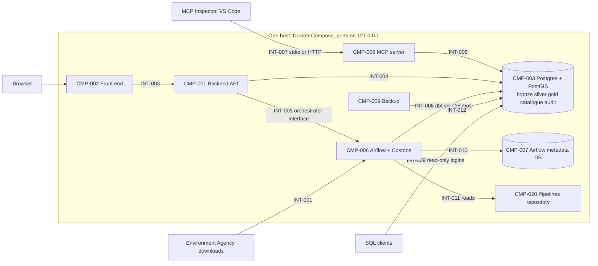

# 10 Architecture and deployment

| Doc | Version | Status | Updated | Baseline |
|---|---|---|---|---|
| SPEC-10 | 0.1 | draft | 2026-11-14 | application-definition 1.0 |

Deployment category: local

## Overview and boundaries
One Docker Compose project on one host (DEF-02 and the source's hosting decision). The web app (backend and front end) is the only thing people open; Airflow is embedded, owned by the app and never exposed; the MCP server shares the backend's service layer; consumers reach published data through four doors in Phase 0 (product page, SQL, MCP, export) and three more from Phase 2 (OGC API Features, REST, OData). Every door asks one access service (FR-071) and returns the tier and caveats with the data.

## Components
Built from is a catalogue asset (`CAT-nnn` and version), `custom`, or `external` (a third-party component not yet approved in the catalogue). The five Phase 0 libraries were imported on 2026-11-14 and approved at Gate 2 (CAT-100 to CAT-104).

| CMP | Component | Role | Built from | Runtime | Phase |
|---|---|---|---|---|---|
| CMP-001 | Backend API | Catalogue API, sign-in and roles, access service, tier and promotion logic, product page data, export, review queue, run history, orchestrator client | CAT-006 1.4.0 (web-app backend, adapted) | Python 3.12, FastAPI; container | 0 |
| CMP-002 | Front end | Sign-in, catalogue list, five-tab product page, steward and owner lists, admin, run history, licence register, tokens | CAT-006 1.4.0 (web-app front end, adapted) | React 19, Vite; container | 0 |
| CMP-003 | Data database | Postgres 17 with PostGIS 3.5: `bronze`, `silver`, `gold`, `catalogue` and `audit` schemas; read-only login roles | CAT-006 1.4.0 (its `postgis/postgis` 17-3.5 image) | Container, volume `data-db` | 0 |
| CMP-004 | Pipelines package | Manifest validator, DAG factory, orchestrator interface, ingest, checks, freshness, profiling, drift, trust scoring | custom | Python 3.12, imported by the Airflow image and the backend | 0 |
| CMP-005 | dbt project | Silver and gold models, dbt tests, published views and metadata tables | custom, run by CAT-102 1.12.7 (dbt-core) and CAT-103 1.11.0 (dbt-postgres) | dbt in its own virtual environment in the Airflow image (DEC-004) | 0 |
| CMP-006 | Embedded Airflow | Scheduler, DAG processor and API server with the local executor; Cosmos renders each dbt model as a task | CAT-100 3.4.0 (apache-airflow, with Airflow's constraints file) and CAT-101 1.16.0 (astronomer-cosmos) | Containers on the app's network only; no host port | 0 |
| CMP-007 | Airflow metadata database | Airflow's own metadata, separate from the catalogue | CAT-006 1.4.0 (the same database image, its own volume) | Container, volume `airflow-db` | 0 |
| CMP-008 | MCP server | Tools `search_products`, `describe_product`, `query_products` over stdio and streamable HTTP; acts for the token's user through the backend's service layer | custom on CAT-104 2.3.0 (mcp, the official MCP Python SDK) | Python 3.12 in the backend image, its own container | 0 |
| CMP-009 | Backup | Nightly dump of the data and catalogue database, retention and restore script | CAT-006 1.4.0 (template backup container) | Container, volume `backups` | 1 |
| CMP-010 | GeoPackage module | Reads a GeoPackage's features for bronze and writes GeoPackage exports, with the standard library's SQLite (DEC-005) | custom | Python 3.12, used by CMP-004 and CMP-001 | 0 |
| CMP-011 | OGC API Features server | Spatial products as collections over the published views; tier and caveats in collection metadata; access through the backend. Candidate: pygeoapi, CAT-055 (validated, not yet approved) | external: pygeoapi 0.24.0 (CAP-016, approval before EPIC-012) | Container | 2 |
| CMP-012 | REST and OData endpoints | Versioned REST for non-spatial products; OData v4 entity sets with metadata entity sets | custom (in CMP-001) | Python 3.12 | 2 |
| CMP-013 | Pipeline builder | Step library, step forms with previews, pipeline view, Git draft branches, DAG graph | custom (front end in CMP-002, Git service in CMP-001) | React, Python | 2 |
| CMP-014 | Notification sender | Owner notifications, platform alerts and subscriber notices | external: a mail relay chosen in Phase 2 (CAP-019) | Service | 2 |
| CMP-015 | Entra ID | BUUK sign-on and group mapping | external: Microsoft Entra ID (CAP-020) | BUUK tenant | 3 |
| CMP-016 | Reverse proxy with TLS | HTTPS on a domain for the remote MCP server and the app | external: chosen in Phase 3 (CAP-023) | Container | 3 |
| CMP-017 | Copilot agent | Wraps the MCP server for Microsoft 365 Copilot and Teams | external: Copilot Studio or a declarative agent (CAP-021) | Microsoft 365 | 3 |
| CMP-018 | Lineage store | Receives OpenLineage events from Airflow and dbt | external: chosen in Phase 3 (CAP-022) | Container | 3 |
| CMP-019 | Heartbeat | Reports that the app is alive (template feature) | CAT-006 1.4.0 (heartbeat option) | Backend job | 0 |
| CMP-020 | Pipelines repository | Manifests (YAML, fixed key order) and dbt model files in Git, mounted read-only into Airflow | custom | Folder in the app repository | 0 |
| CMP-021 | Source connector library | The connector interface (check version, fetch, describe) and the first connectors: download, upload, HTTP API, Postgres, SQL Server; the connections registry and secret references; the source test. Oracle and OGC API are added later as further connectors | custom (in CMP-004's package); database drivers from the catalogue after approval (POL-10) | Python 3.12, in the Airflow image and the backend | 1 |
| CMP-022 | Door connector library | The door interface (describe, serve) and the existing doors behind it; the door registry; limits, usage logging and tier and caveats applied around every door | custom (in CMP-001's package) | Python 3.12 | 1 |

## Integrations
External systems, and every interface between two components.

| INT | Integration | Kind | From | To | Data | FRs | Failure behaviour |
|---|---|---|---|---|---|---|---|
| INT-001 | Environment Agency Historic Flood Map download | external in | EA file download service | CMP-004 | `Historic_Flood_Map.gpkg.zip` (20 MB, one layer, 21,578 MultiPolygons, EPSG:27700) and the free-text data version file; samples `source/samples/historic-flood-map-schema.md` and `source/samples/historic-flood-map-data-version.txt` | FR-009, FR-010, FR-043 | Run fails with a known issue; the last published version keeps being served |
| INT-002 | Source metadata record (ISO 19139 or GEMINI) | external in | EA catalogue record | CMP-004 | Abstract, extent, contact, update frequency, licence (no real sample yet: RISK-009) | FR-027 | Fields stay Not set; harvest retried at the next run |
| INT-003 | Front end to backend | http | CMP-002 | CMP-001 | JSON API under `/api`, cookie session | FR-050, FR-052, FR-058, FR-066 | Error states on the page; no partial saves |
| INT-004 | Backend to data database | database | CMP-001 | CMP-003 | Catalogue reads and writes; previews and exports under the user's read-only login | FR-002, FR-071, FR-094 | Request fails with a safe message; logged |
| INT-005 | Orchestrator interface | http | CMP-001 | CMP-006 | Manifest in (trigger, schedule); run status, step logs and check results out, through Airflow's REST API and the catalogue tables the tasks write | FR-041, FR-042 | Run history shows "orchestrator unreachable"; nothing else in the app depends on Airflow |
| INT-006 | dbt through Cosmos | database | CMP-006 | CMP-003 | Silver and gold models, tests, published views; pipeline role limited to bronze, silver and gold (SEC-016) | FR-018, FR-019, FR-039 | Failed model is a failed task with its log; gold keeps the last published view |
| INT-007 | MCP clients | client in | MCP Inspector, VS Code | CMP-008 | MCP over stdio or streamable HTTP with a personal access token; sample responses are produced by TEST-041 (local tools, no outside sample needed) | FR-082, FR-087 | Tool returns an error with a reason; nothing half-done |
| INT-008 | MCP server to the data | database | CMP-008 | CMP-003 | Read-only SELECT under the token user's login; catalogue reads through the shared service layer | FR-084, FR-085 | Statement timeout gives a clear error |
| INT-009 | SQL clients | client in | DBeaver, notebooks, Power BI's PostgreSQL connector, QGIS | CMP-003 | Read-only logins on published views and metadata tables; no outside data enters, so no sample is needed (connection details are the platform's own) | FR-072, FR-020 | Login refused or permission denied |
| INT-010 | Airflow metadata | database | CMP-006 | CMP-007 | Airflow's own state | FR-038 | Airflow down: runs wait; app shows run history from the catalogue |
| INT-011 | Pipelines repository | file | CMP-020 | CMP-006 | Manifests and dbt files read by the DAG factory | FR-038, FR-040 | Invalid manifest produces no DAG and an error in run history |
| INT-012 | Backup | database | CMP-009 | CMP-003 | Read-only dump | FR-100 | Fails loudly; a partial dump never counts as fresh |
| INT-013 | OGC API Features clients | external in | QGIS, ArcGIS | CMP-011 | Collections and items with tier and caveats (no real sample yet: RISK-009) | FR-097 | Refused without access |
| INT-014 | OData and REST clients | external in | Power BI, Excel, internal apps | CMP-012 | Entity sets, metadata entity sets, versioned JSON (no real sample yet: RISK-009) | FR-098, FR-099 | Refused without access; rate limited |
| INT-015 | Notifications | external out | CMP-001 | CMP-014 | Owner, admin and subscriber messages (no real sample yet: RISK-009) | FR-101, FR-102 | Queued and retried |
| INT-016 | Entra sign-on | external in | CMP-015 | CMP-001 | OpenID Connect tokens and group claims (no real sample yet: RISK-009) | FR-080 | Sign-in refused; no local fallback in production |
| INT-017 | Copilot agent to remote MCP | external in | CMP-017 | CMP-008 via CMP-016 | MCP over HTTPS, streamable transport, Entra tokens (no real sample yet: RISK-009) | FR-089, FR-092 | Tool error with reason |
| INT-018 | Lineage events | external out | CMP-006 | CMP-018 | OpenLineage events from Airflow and dbt (no real sample yet: RISK-009) | FR-104 | Events buffered; lineage view says when it is stale |
| INT-019 | Internal HTTP APIs | external in | an internal API | CMP-021 | JSON pages with an API key, bearer token or OAuth2 token (no real sample yet: RISK-009) | FR-015, FR-119 | Run fails with a known issue; last published version served |
| INT-020 | On-premises and cloud databases (Postgres, SQL Server) | external in | a source database on another VM or in Azure or AWS | CMP-021 | Rows by table or query under a read-only account; network route per source (Q-004; no real sample yet: RISK-009) | FR-017 | Run fails with a known issue; no partial load kept |
| INT-021 | External HTTP APIs | external in | a third-party API | CMP-021 | JSON pages, keyed or key-less (no real sample yet: RISK-009) | FR-015, FR-119 | Run fails with a known issue; rate-limit replies back off and retry |
| INT-022 | Secrets store | file | Docker secrets (later the company vault) | CMP-021 | Connection secrets read at run time by name | FR-121 | A missing secret fails the run with "secret not found" and no value shown |

## Technology and rationale
- **From the template (CAT-006):** FastAPI, async SQLAlchemy and Alembic, Pydantic settings, structlog; React 19, Vite, TanStack Query, `ManagedDataTable` and `ServerTable`; PostGIS image; Compose, CI and backup container. The sample sites and surveys domain is removed.
- **Added for requirements:** Airflow 3.4.0 with its constraints file and Cosmos 1.16.0 (FR-038, FR-039); dbt-core 1.12.7 with dbt-postgres 1.11.0 in their own virtual environment, because they conflict with Airflow's constraints on `pathspec` (DEC-004, `source/samples/install-check-2026-11-14.md`); the official MCP Python SDK 2.3.0 (FR-082 to FR-087). No other framework (DEF-15).
- **GeoPackage:** read and written with Python's standard SQLite module (DEC-005); GDAL is used only inside a test container to check exports.
- **Not used:** any storage other than Postgres; any model client (OBJ-009).

## Environments and configuration
- **Phase 0:** one local Compose stack on the owner's Windows machine. **From Phase 1 (DEC-016):** the pilot runs on a BUUK-hosted VM or server on the internal network, with development, staging and production as separate stacks (FR-106, pulled forward from Phase 3). The hub's VM must have a route to each pilot source, on other VMs or in Azure or AWS (Q-004); a source-network runner (FR-120) is held until a source has no route.
- **Configuration (YAML, in the repository):** `config/trust.yaml` (weights, thresholds, caps), `config/freshness.yaml` (cadence thresholds), `config/limits.yaml` (row and rate limits), `config/drift.yaml`, `config/sources.yaml` (download and version links), `config/mcp.yaml` (minimum-tier floor).
- **Environment names (values in the git-ignored `.env`, never in the repository):** `POSTGRES_PASSWORD`, `APP_DB_PASSWORD`, `PIPELINE_DB_PASSWORD`, `AIRFLOW_DB_PASSWORD`, `AIRFLOW_API_USER`, `AIRFLOW_API_PASSWORD`, `AIRFLOW_FERNET_KEY`, `JWT_SECRET`, `ADMIN_EMAIL`, `ADMIN_PASSWORD_HASH`, `READONLY_ROLE_PREFIX`, `HEARTBEAT_URL`. Startup refuses missing or placeholder values (SEC-002).
- **Ports (chosen after `docker ps` at build time, 127.0.0.1 only):** front end in 52xx, backend in 80xx, data database in 54xx (for the SQL door), MCP HTTP in 80xx. Airflow's API server and both databases' internal ports are not published except the data database's SQL door.

## Running it
- **Start:** `docker compose up -d`; **stop:** `docker compose down` (volumes kept); **tests:** one command in clean containers (US-001).
- **Volumes:** `data-db`, `airflow-db`, `backups`, `bronze-files` (downloaded zips during load only).
- **Backup and restore (Phase 1):** nightly dump; `scripts/restore.sh <dump>`; bronze keeps four versions for rollback (FR-011, FR-012).
- **Health:** each container has a health check; the backend's `/api/health` reports database and orchestrator status; heartbeat on.
- **Reset:** `docker compose down -v` deletes all data (needs the owner's approval each time, POL-07).

## Logging, observability and releases
- Structured logs (structlog) in every Python component; Airflow task logs copied to the run history (FR-041).
- Run history, check results and the audit log are the operational record; alerting arrives in Phase 2 (FR-101).
- Releases follow the phases; Airflow is upgraded about every six months plus security patches, on a copy first, with the DAG factory's contract tests (NFR-010).

## Cost drivers and limitations
- No paid services in Phases 0 to 2. Phase 3 needs Microsoft licences and Copilot Studio credits (DEP-004) and a domain and certificate.
- Memory: about 6 to 8 GB for the whole stack (NFR-002), within the 16 GB Docker Desktop gets on the 32 GB machine.
- Limitation: the spatial performance of Postgres on the real flood map is unproven until TEST-102 (RISK-007).
