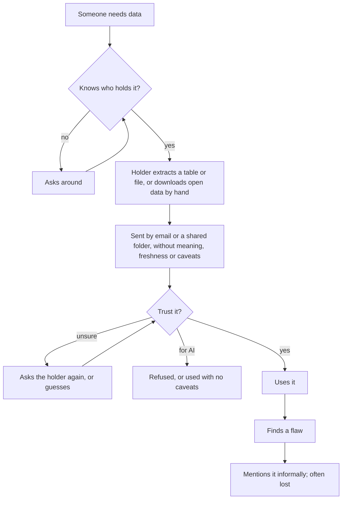
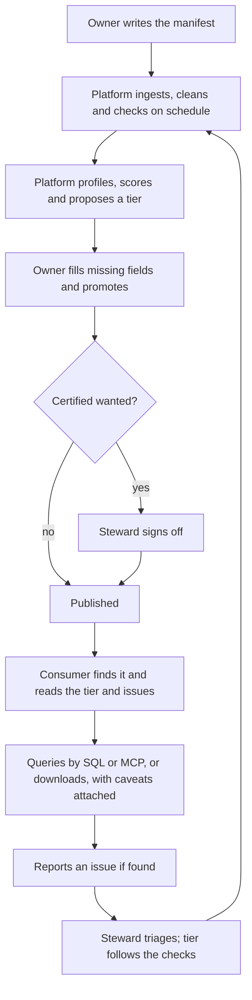

# 13 Business process

| Doc | Version | Status | Updated | Baseline |
|---|---|---|---|---|
| SPEC-13 | 0.1 | draft | 2026-11-14 | application-definition 1.0 |

How the work is done today, how it will be done with the app, and what changes. Plain enough for the people who do the work to check it. Each section needs a Mermaid flowchart; each to-be step names the requirements (FR) it relies on.

## As-is
Today (from the source's problem statement): a person or an AI tool that needs data asks whoever holds it, or is pointed at a raw table or file. The data arrives without its meaning, freshness, known weaknesses, owner or permitted use. The consumer guesses, or asks again; AI use is refused outright ("the data isn't trustworthy enough for AI") or happens without caveats. Flaws found along the way are mentioned in passing and rarely reach the data's owner, so the next person hits them too. External open data (such as the flood map) is downloaded by hand by whoever needs it, each copy of a different age.

## To-be
Owners publish each product once from a manifest; the platform builds, checks, scores and documents it, and every door returns the data with its tier and caveats. People see exceptions, not everything.

| Step | Who | What happens | Relies on |
|---|---|---|---|
| 1 | Steward | Adds the source's licence to the register before anything is loaded | FR-004, FR-005 |
| 2 | Owner | Writes the manifest in Git (Phase 2: in the form builder); a bad manifest is refused with reasons | FR-002, FR-003, FR-045 |
| 3 | Platform | Generates the DAG; on schedule checks the source version, ingests to bronze, builds silver and gold, runs checks | FR-038, FR-009, FR-010, FR-018, FR-021, FR-043 |
| 4 | Platform | Profiles, works out freshness, opens issues from failed checks, scores and proposes a tier, records the run | FR-025, FR-023, FR-022, FR-028, FR-029, FR-042 |
| 5 | Owner | Reviews the generated page, fills missing fields, promotes when the gate passes | FR-060, FR-034, FR-032, FR-037 |
| 6 | Steward | Signs off Certified where wanted; triages findings; overrides a tier with a reason | FR-033, FR-059, FR-030 |
| 7 | Owner and admin | Set the access level, groups and named grants; admin manages users and groups | FR-069, FR-067, FR-068 |
| 8 | Consumer | Finds the product and judges it from its page | FR-050, FR-052 |
| 9 | Consumer | Queries the published view by SQL, with tier and issues in the metadata tables | FR-072, FR-020 |
| 10 | Consumer | Downloads a file with its sidecar and version file | FR-094, FR-095 |
| 11 | Consumer through an AI tool | Searches, describes and queries over MCP; the answer carries combined caveats and the weakest tier | FR-082, FR-083, FR-084, FR-085 |
| 12 | GIS and BI users (Phase 2) | Connect QGIS, Power BI or Excel through OGC API Features or OData | FR-097, FR-099 |
| 13 | BUUK staff (Phase 3) | Ask in Copilot; the agent answers through the MCP server with tier and caveats | FR-092, FR-089 |
| 14 | Consumer | Reports an issue (Phase 3: an agent can too); asks for access or a dataset (Phases 2 and 3) | FR-058, FR-088, FR-103, FR-062 |
| 15 | Platform | A failed blocking check lowers the tier while the last version keeps serving; passing restores it | FR-022, FR-031 |
| 16 | Admin | Backs up nightly, rolls back a bad load, watches usage; promotes between environments (Phase 3) | FR-100, FR-012, FR-105, FR-106 |

## What changes
Change is removed, automated, changed or new. The saving is the expected time or errors saved, per occurrence or per period. Savings are estimates to check in the pilot.

| Step | Change | Who does it now | Who does it then | Expected saving |
|---|---|---|---|---|
| Find out who holds the data | removed | Consumer, by asking around | Nobody: the catalogue lists every product with its owner | Hours per request; the round of asking disappears |
| Extract and send a file | automated | Data holder, per request | The platform, through four doors | One extraction per request saved |
| Download open data by hand | automated | Each person who needs it | The platform, weekly version check and quarterly refresh | Several stale private copies replaced by one current product |
| Judge whether to trust the data | changed | Consumer, by guessing or asking | Consumer, from the tier, freshness and issues shown with the data | Fewer wrong uses; caveats never separated from the data |
| Decide whether AI may use the data | changed | Refused outright or ignored | Licence and AI-use flag enforced by the platform | AI use possible for permitted products, with caveats |
| Report a flaw | changed | Informal mention, often lost | Register entry triaged by a steward and tracked to a fix | Each flaw fixed once for everyone |
| Document a dataset | changed | Rarely done, by hand | Generated from profiling and harvested metadata; owner fills only the gaps | Most of the page with no writing |
| Check quality after each refresh | new | Nobody | The platform, at every layer boundary | Regressions caught before consumers see them |
| Control who sees what | changed | Ad hoc, per file sent | One access rule on every door, audited | No leaked copies; access changes traceable |
